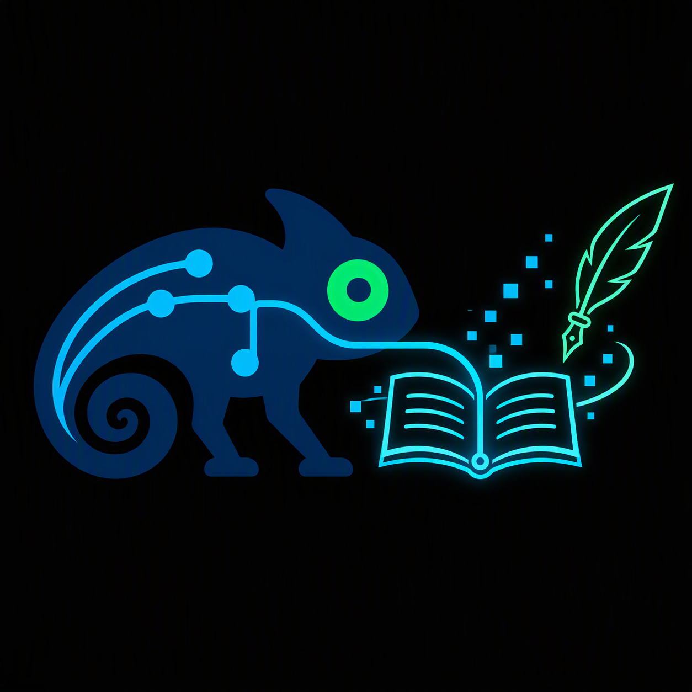

# 📚 La meua biblioteca digital

Benvinguts a aquest espai de filologia i literatura al 100%. En aquest repositori recullo la meua vena literària i serveix com a testimoni del meu superpoder camaleònic amb la meua versatilitat com a escriptora multiveu, mimetitzar-me en diferents registres, situacions i estils textuals.

El recull conté el **Repte Hackató**. Després hi ha un recull de fragments on mostro el meu camaleonisme en textos diferents entre ells que es pot aplicar en món editorial com a *Ghostwriter* o revisora editorial. Per últim, hi ha una mostra de la meua forma d'analitzar la literatura a partir de diversos fragments d'estudi literari.
 

---

# 🎯 Projectes Literaris

A continuació, trobareu els tres eixos que formen part d'aquesta col·lecció digital:

### 1. El Repte de l'Idiolecte
Aquest text és un joc interactiu i un desafiament per al lector, creat i preparat expressament per a la **HackEPS [LleidaHack]**. L'objectiu és: endevinar qui parla a cada línia a través de les marques de parla particulars, psicologia del personatge, etc. Una demostració pràctica de com en la llengua es pot trobar una base de la identitat de qui la utilitza; com edat, professió o procedència, entre altres.

🔗 **Accés al repte:** [**El Repte de l'Idiolecte**](repte-idiolecte.md)

### 2. Recull de textos: La veu camaleònica
Una selecció detallada de mostres de diferents tipus de personatges, relats, veus i psicologia. Aquest recull s'ha estructurat com una exhibició de la meua versatilitat en registres i veus. Cada text canvia completament de to i atmosfera, demostrant la capacitat d'adaptar-me a diferents contextos literaris i psicològics.
* **Lo triomf de la cendra:** Una narració de tall clàssic i èpic sobre el retorn d'un cavaller al seu poble natal.
* **Els perfums evaporats:** Un relat reflexiu i íntim sobre el pas del temps, la vellesa i la memòria de la padrina.
* **Sense perdre un segon:** Un text amb un marcat caràcter pragmàtic, directe i empresarial sobre la superació del fracàs.
* **Escapada al clar de la lluna:** Una prosa dinàmica, juvenil i d'acció sobre una fugida d'una escola de màgia.

🔗 **Explorar el recull:** [**Recull de Veus i Registres**](recull-veus/)

### 3. Recull d'anàlisis literàries
Un recull de textos dedicats a l'anàlisi de diverses obres i conceptes. Aquest espai està pensat perquè veieu com analitzo la literatura, com desitjo desgranar els textos i de quina manera faig connexions crítiques profundes entre autors, estils i moviments.

⚠️ **Avís per a navegants (Anàlisi en profunditat):** Els textos que trobareu aquí dins són exercicis de crítica literària i estructuralista. S'hi utilitzen conceptes acadèmics complexos i anàlisis de fons que requereixen paciència; si no us agrada la teoria pura, us poden semblar un bon rotllo! Quedeu avisats.

Dins d'aquest bloc trobareu:
* **Anàlisi estructuralista de l'anunci “Smoking causes blindness”:** Un estudi semiòtic i conceptual sobre la metàfora de l'ull com a jutge i presó en una campanya antitabac.
* **Anàlisi psicològica dels personatges de *La Ventafocs*:** Un recorregut comparatiu de la psicologia i evolució dels personatges des de la versió xinesa del segle IX fins als Grimm.
* **Leitmotiv en *El procés* de Kafka:** Un tast de mètode sobre el símbol de les mans com a fil conductor de la impotència davant la Llei.
* **Leitmotiv d'*El cavaller inexistent* d'Italo Calvino:** Un estudi sobre la paradoxa de l'armadura blanca, plena de voluntat però buida de cos.

🔗 **Consultar assajos:** [**Recull d'Anàlisis Literàries**](recull-analisis/)

---

# 🚀 Humanitats Digitals: La Filologia com a Base de la Programació 

Més enllà de la creació purament artística, la filologia i el coneixement profund de l'estructura de la llengua són eines clau per a realitzar projectes tecnològics innovadors. Aquests són uns exemples d'aplicacions i de projectes pràctics que es poden desenvolupar amb el meu superpoder:

* **🎮 Disseny Narratiu de Videojocs (*Narrative Design*):** Construcció d'una història profunda d'un videojoc amb sentit i ramificacions complexes (arbres de decisió lògics), alhora que es doni la veu, la sintaxi i el registre dialectal o social que toca a cada personatge (NPC) segons la seua psicologia i entorn.
* **🛡️ Ciberseguretat i Lingüística Forense (*Atribució d'Autoria*):** Es disposa de coneixements metodològics per poder dissenyar un programa que compari diverses mostres d'una persona en un text sense autoria oficial, per descobrir si realment és seu o no. L'algorisme es basa en la comparació d'estructures inconscients, l'ordre de les paraules, mots funcionals i tics lèxics invisibles per a un lector comú.
* **🌐 Adaptació Territorial de Continguts Web:** Disseny de la lògica perquè un codi informàtic interpreti mapes dialectals (com l'Atles de Joan Veny i Lídia Pons) i adaptar automàticament qualsevol text o web al parlar local de l'usuari en restaurants, webs, entre altres, que volen ser de proximitat d'una zona concreta.
* **🤖 Anàlisi Literària Automatitzada:** Domini de l'estructura de les històries i la literatura per guiar programes d'intel·ligència artificial a localitzar motius, temàtiques recurrents o arquetips dins d'un corpus massiu de textos de l'àmbit editorial o filològic.

---

## 🔒 Avís de Copyright i Llicència

⚠️ **Tots els drets reservats.** 

© 2026 [Enginyera Filològica]. Queda totalment prohibida qualsevol forma de reproducció, distribució, còpia, modificació, traducció o ús comercial dels textos i anàlisis d'aquest repositori sense l'autorització expressa i per escrit de l'autora. Vegeu el fitxer [LICENSE](LICENSE) per a més detalls.
